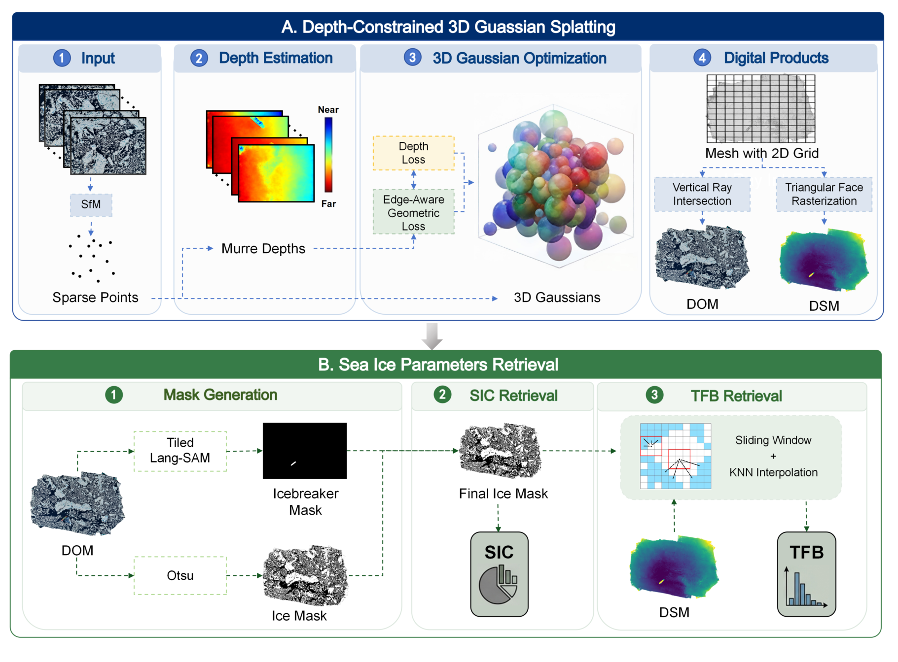

# SeaIceGS

[](#publication)
[](#publication)
[](https://doi.org/10.1109/JSTARS.2026.3753633)

**SeaIceGS: Depth-constrained 3D Gaussian Splatting for Sea Ice Concentration and Total Freeboard Estimation from Polar UAV Imagery**

Quanjian Ji, Tengfei Wang, Yifei Yu, Zhe Shen, Shuhang Zhang, Yue Shen, Tianxing Wang, Zhuoqi Chen, Songtao Ai, Xin Wang, and Zongqian Zhan

*IEEE Journal of Selected Topics in Applied Earth Observations and Remote Sensing (JSTARS), 2026.*

[Paper (IEEE Xplore)](https://ieeexplore.ieee.org/document/11794150) · [DOI](https://doi.org/10.1109/JSTARS.2026.3753633) · [Citation](#citation) · [Sea-Ice Retrieval Code](https://github.com/QuanJianji/IceRetrieval)

SeaIceGS reconstructs sea-ice scenes from multi-view imagery using depth-constrained 3D Gaussian Splatting. The framework connects 3D reconstruction with digital orthophoto map (DOM) and digital surface model (DSM) generation, supporting downstream sea ice concentration (SIC) and total freeboard (TFB) retrieval.

[Method Overview](#method-overview) · [Installation](#installation) · [Data Preparation](#data-preparation) · [Training](#training) · [Mesh Extraction](#rendering-and-mesh-extraction) · [Digital Products](#digital-product-generation) · [Sea-Ice Retrieval](#sea-ice-parameter-retrieval)

## Publication

The SeaIceGS paper has been accepted by **IEEE Journal of Selected Topics in Applied Earth Observations and Remote Sensing (JSTARS)** and is now [available online through IEEE Xplore](https://ieeexplore.ieee.org/document/11794150). The published article is identified by DOI [10.1109/JSTARS.2026.3753633](https://doi.org/10.1109/JSTARS.2026.3753633).

## Method Overview

<p align="center">
  <a href="assets/seaicegs_pipeline.png">
    
  </a>
</p>

*Overview of the SeaIceGS framework. Part A reconstructs a Gaussian scene and generates DOM/DSM products. Part B uses these products for sea-ice mask generation, SIC estimation, and TFB retrieval.*

The workflow has two parts:

1. **Depth-constrained 3D reconstruction and digital product generation.** Structure from Motion (SfM) provides camera poses and sparse points. Murre depth estimates provide geometric priors for Gaussian optimization, together with depth and edge-aware geometric constraints. Rendered depth maps are fused into a mesh using TSDF, and the mesh is used to generate DOM and DSM products.
2. **Sea-ice parameter retrieval.** The DOM is used to generate an ice mask with Otsu thresholding and an icebreaker mask with tiled Lang-SAM segmentation. These masks are combined into a final ice mask for SIC estimation. The DSM and masks support TFB retrieval using a sliding window and KNN interpolation.

This repository provides the reconstruction and digital product generation components. The downstream mask generation and SIC/TFB retrieval workflow is maintained in [IceRetrieval](https://github.com/QuanJianji/IceRetrieval).

## Project Layout

```text
SeaIceGS/
  arguments/              # command-line parameter groups
  gaussian_renderer/      # Gaussian rasterization and rendering interface
  scene/                  # camera, dataset, and Gaussian model definitions
  utils/                  # geometry, image, loss, and system utilities
  submodules/             # CUDA extensions used by the renderer
  assets/                 # paper framework figure used in this README
  train.py                # training entry point
  render.py               # rendering and mesh extraction entry point
  DigitalProduct.py       # DOM and DSM generation from exported mesh
  metrics.py              # image quality metrics
  TSDF.py                 # TSDF fusion utility
  requirements.txt
```

## Installation

Clone the repository:

```bash
git clone https://github.com/IRIS-LAB-whu/SeaIceGS.git
cd SeaIceGS
```

Create and activate a conda environment:

```bash
conda create -n SeaIceGS python=3.8 -y
conda activate SeaIceGS
```

Install PyTorch according to your CUDA version. For example:

```bash
pip install torch torchvision torchaudio --index-url https://download.pytorch.org/whl/cu118
```

Install Python dependencies and CUDA extensions:

```bash
pip install -r requirements.txt
pip install submodules/diff-plane-rasterization
pip install submodules/simple-knn
```

Download the VGG16 checkpoint used by LPIPS:

```bash
mkdir -p vgg_checkpoint
wget https://download.pytorch.org/models/vgg16-397923af.pth -O vgg_checkpoint/vgg16-397923af.pth
```

## Data Preparation

SeaIceGS expects a reconstructed image dataset with camera parameters. A typical custom dataset can be arranged as:

```text
data/
  scene_name/
    images/
      image_0001.jpg
      image_0002.jpg
      ...
    murre_out/
      depth_bw/
      depth_colored/
      depth_npy/
        image_0001_pred.npy
        image_0002_pred.npy
        ...
    sparse/
      0/
        cameras.bin
        images.bin
        points3D.bin
```
 For murre_out folder, please follow the lead of [Murre](https://github.com/zju3dv/Murre)
 For polar sea-ice imagery, DOM and DSM products can also be generated with SeaIceGS outputs or with photogrammetry software such as Metashape Professional.

## Training

Run training with:

```bash
python train.py \
  -s /path/to/data/scene_name \
  -m /path/to/output/scene_name \
  --max_abs_split_points 0 \
  --opacity_cull_threshold 0.05
```

Main parameters are defined in `arguments/__init__.py`.

## Rendering and Mesh Extraction

To extract a mesh with TSDF fusion:

```bash
python render.py \
  -m /path/to/output/scene_name \
  --max_depth 500.0 \
  --voxel_size 0.01 \
```

## Digital Product Generation

After mesh extraction, the 3DGS output directory should contain a `mesh/` folder. Generate DOM and DSM GeoTIFF products with:

```bash
python DigitalProduct.py \
  --input /path/to/output/scene_name \
  --resolution 0.4
```

The script searches `mesh/` for `tsdf_fusion_scaled.ply`, `tsdf_fusion_post.ply`, or `tsdf_fusion.ply` in order, and writes:

```text
/path/to/output/scene_name/digital_products/DOM.tif
/path/to/output/scene_name/digital_products/DSM.tif
```

If multiple mesh files exist and a specific one is needed, specify it with `--mesh-name`.

## Sea-Ice Parameter Retrieval

For mask generation, sea ice concentration (SIC), and total freeboard (TFB) retrieval from the generated DOM and DSM, see [IceRetrieval](https://github.com/QuanJianji/IceRetrieval).

## Notes for Sea-Ice Scenes

- Use high-overlap imagery when possible; sea ice often contains low-texture and repeated patterns.
- Adjust `--max_depth` and `--voxel_size` according to scene scale.
- For noisy or incomplete viewpoints, enable `--use_depth_filter` during mesh extraction.
- Reduce `--opacity_cull_threshold` carefully when thin ice fragments or small floes need to be preserved.

## Citation

If you use SeaIceGS in your research, please cite our paper:

```bibtex
@article{ji2026seaicegs,
  author  = {Ji, Quanjian and Wang, Tengfei and Yu, Yifei and Shen, Zhe and Zhang, Shuhang and Shen, Yue and Wang, Tianxing and Chen, Zhuoqi and Ai, Songtao and Wang, Xin and Zhan, Zongqian},
  title   = {{SeaIceGS}: Depth-constrained {3D} Gaussian Splatting for Sea Ice Concentration and Total Freeboard Estimation from Polar {UAV} Imagery},
  journal = {IEEE Journal of Selected Topics in Applied Earth Observations and Remote Sensing},
  year    = {2026},
  pages   = {1--18},
  doi     = {10.1109/JSTARS.2026.3753633},
  url     = {https://ieeexplore.ieee.org/document/11794150}
}
```

## Acknowledgements

SeaIceGS is built on top of prior work including:

- [3D Gaussian Splatting](https://github.com/graphdeco-inria/gaussian-splatting)
- [PGSR](https://github.com/zju3dv/PGSR)
- [Murre](https://github.com/zju3dv/Murre)
- [Lang-SAM](https://github.com/luca-medeiros/lang-segment-anything)
- COLMAP, related evaluation/preprocessing tools and ShetlandsUAVmetry: Deception Island

Please follow the original licenses and citation requirements of these projects.

## License

This repository contains code derived from third-party research projects. Use is governed by `LICENSE.md` and the licenses of included third-party components. Copyright and attribution notices must be retained.
